<h1 align="center">VH SimGrid</h1>

  
  
  
  

  
  
  
  

## Descripción

Ecosistema **simracing DIY completo**, desarrollado y probado sobre hardware real:

- **VH Grid DD15**: volante direct drive de force feedback. Windows lo detecta
  como un volante FFB nativo (USB HID PID), sin drivers ni software residente
- **VH Axis**: pedalera de 3 pedales. Acelerador y embrague con sensores Hall,
  y freno con célula de carga (mide fuerza real, no recorrido)
- **VH Formula Apex**: aro con tira de LEDs de RPM y eventos, matriz de
  botones y encoders, configurable al detalle desde la app
- **VH SimGrid**: la aplicación de escritorio que configura los tres
  periféricos en vivo, sin reflashear. Además trae **dash**, **ingeniero de
  pista por voz** y **análisis de telemetría**

Este repositorio contiene **las descargas oficiales** (instalador y firmwares).
Es el único canal de distribución.

## Descargas

En [Releases](../../releases) encontrarás, para cada versión:

| Fichero | Qué es |
|---|---|
| `VH-SimGrid-Setup-vX.Y.Z.exe` | **Instalador de Windows (recomendado)**: la app y los firmwares. No pide permisos de administrador. |
| `VH-GridDD15-firmware-vX.Y.Z.hex` | Firmware del volante, solo para flasheo manual con STM32CubeProgrammer. |
| `VH-Axis-pedalera-vX.Y.Z.hex` | Firmware de la pedalera, solo para flasheo manual con arduino-cli/avrdude. |
| `VH-FormulaApex-aro-vX.Y.Z.hex` | Firmware del aro, solo para flasheo manual con arduino-cli/avrdude. |

## Instalación

1. Descarga y ejecuta el instalador de la última release.
2. Abre **VH SimGrid**: los periféricos se detectan y conectan solos. La
   primera vez, un asistente te guía por el volante, los pedales, el aro y la
   telemetría de tus juegos.
3. Las actualizaciones de firmware se hacen **desde la propia app**, sin
   herramientas externas: al conectar un periférico, si hay firmware nuevo la
   app te ofrece grabarlo con un clic. El volante ni siquiera necesita el
   jumper BOOT0, y el aro y la pedalera se graban sin instalar nada.

> El único flasheo manual es el primero del volante (placa nueva, sin firmware):
> ponla en DFU con el jumper BOOT0 y flashea el `.hex` con STM32CubeProgrammer.
> Al actualizar, el instalador conserva perfiles, dashes y calibración.

## La aplicación, página a página

La barra de la izquierda lleva a cada parte. Todo se aplica en vivo: los
periféricos no se reflashean para cambiar un ajuste.

### Inicio

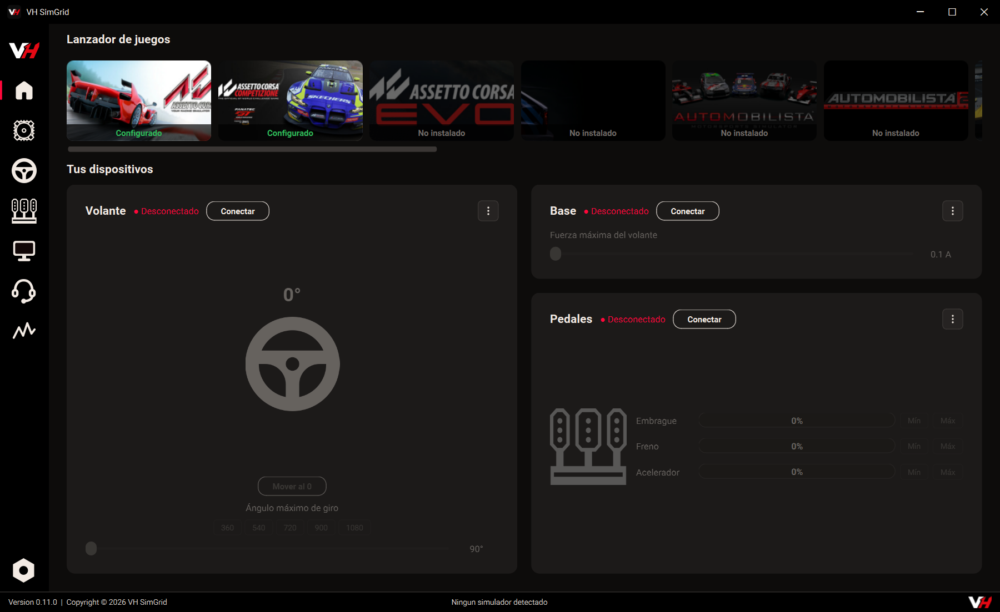

- **Lanzador de juegos**: los simuladores que tienes instalados, con su
  carátula. Indica cuáles tienen ya la telemetría configurada y los abre con
  un clic
- **Tus dispositivos**: una tarjeta por periférico con su estado (conectado o
  no) y lo que se toca a diario: el giro y la fuerza máxima del volante, y el
  recorrido en vivo de cada pedal

### Volante (VH Grid DD15)

El volante es un FFB nativo de DirectInput: constant force, spring, damper,
friction e inertia, cada uno con su ganancia. Arriba se elige el **perfil**
(GT3, Formula, Rally...), que se puede aplicar solo al detectar el juego.

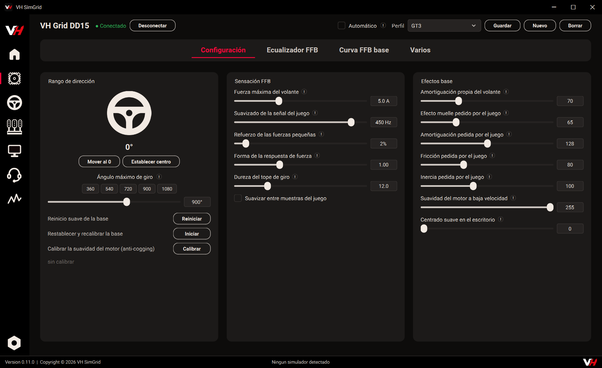

- **Configuración**: rango de giro (de 90° a 1440°) y centrado, la sensación
  general (fuerza máxima, suavizado de la señal, refuerzo de las fuerzas
  pequeñas, dureza del tope de giro) y los efectos base del volante
  (amortiguación, fricción, inercia). Aquí están también el reinicio de la
  base y la calibración **anti-cogging**, que elimina el rizado magnético del
  motor y se guarda en flash
- **Ecualizador FFB**: 6 bandas de 5 a 60 Hz, cada una del 0 al 500 %, para
  decidir qué se nota más: el peso de la dirección, los golpes, los pianos, el
  ABS, la hierba y la grava, o la textura fina del asfalto

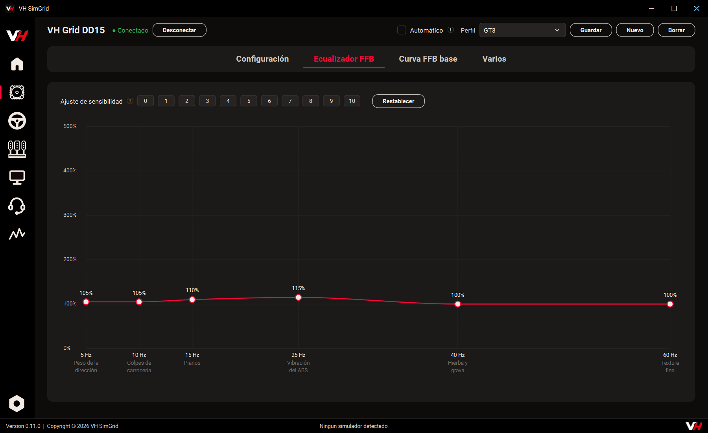

- **Curva FFB base**: la curva de 9 puntos que traduce la fuerza que pide el
  juego en la fuerza que da el motor, con preajustes
- **Varios**: el estado del motor en vivo, un registro de los últimos
  segundos del giro y de la fuerza con la línea de clipping marcada, y las
  opciones y el mantenimiento de la base

La base lleva guardia de sobrevelocidad, protección térmica, tope de giro
progresivo, limitador de regeneración y detector de oscilaciones, probados en
choques reales.

### Aro (VH Formula Apex)

- **Configuraciones generales**: vista previa de la tira de LEDs, brillos
  (también el de noche, cuando el coche lleva las luces encendidas), apagado
  de la tira sin juego, y el modo y punto de mordida de las **palancas de
  embrague**
- **Configuración de las RPM**: cómo se comporta la barra de revoluciones
  (modo, llenado, reinicio al cambiar de marcha) y el umbral de cada LED.
  Puede ajustarse sola al régimen real de cada coche

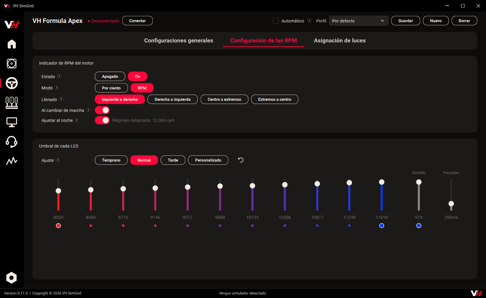

- **Asignación de luces**: qué enciende cada LED. Banderas, TC/ABS/DRS/ERS,
  limitador y pit lane, coches cerca, barras de freno, acelerador y
  combustible... cada efecto con su rango de LEDs, sus colores y su estilo
  (fijo, parpadeo, respiración, desplazamiento). Se agrupan en carpetas y se
  guardan en perfiles por juego y por coche

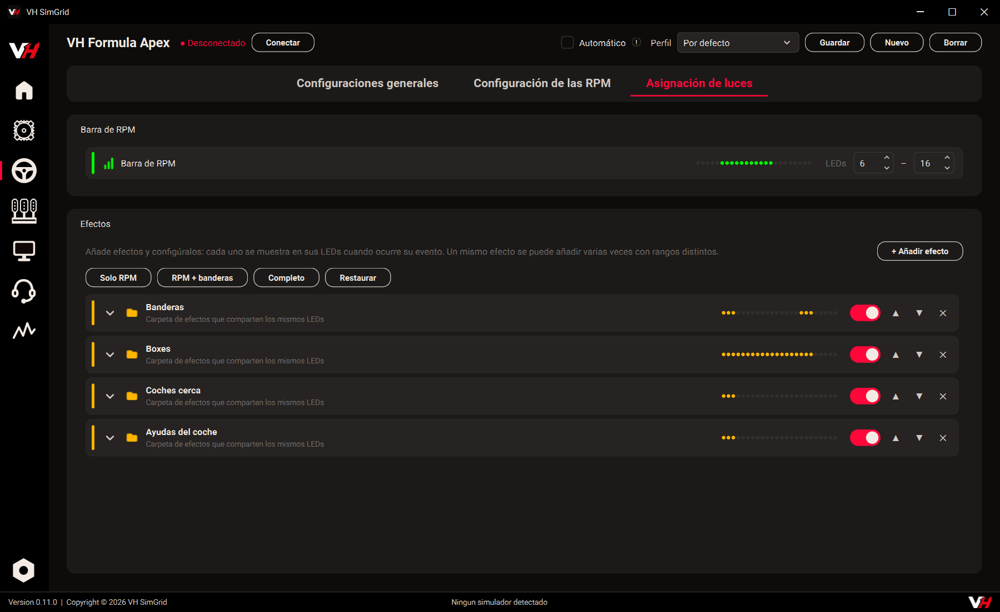

La matriz de botones y los encoders del aro funcionan como botones de mando
normales, y el aro recuerda su brillo aunque arranque sin PC.

### Pedalera (VH Axis)

Una sola página con los tres pedales, acelerador, freno y embrague, y arriba
la **traza en vivo** de los tres.

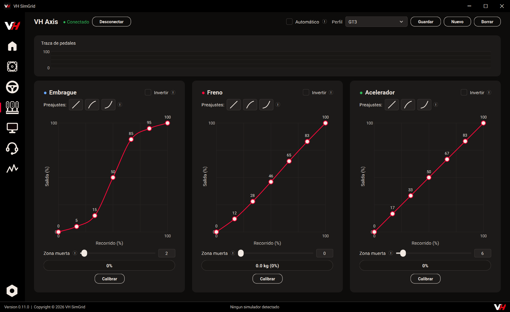

- **Curva de respuesta** arrastrable por pedal, con preajustes, zona muerta e
  inversión del sentido
- **Calibración guiada**: reposo y fondo de cada pedal. El freno se calibra
  en **kilos** gracias a la célula de carga
- Lo que se cambia se guarda solo en la EEPROM de la pedalera. Los pedales se
  leen a unos 1000 Hz con filtrado del ruido del sensor

### Dash

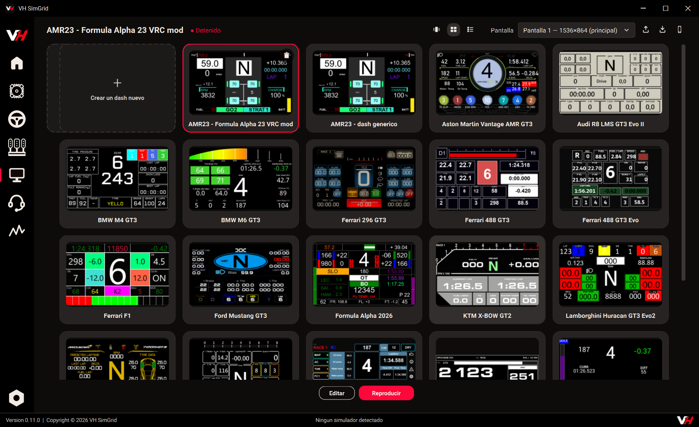

- **Galería**: los dashes disponibles, **20 de serie** (GT3, F1, Formula
  Alpha 2026...). Se elige el monitor y se le da a *Reproducir*. Un **móvil**
  también puede ser una pantalla: se vincula con un código QR. Los dashes se
  exportan e importan en un `.zip`
- **Editor**: se diseña un dash desde cero o se retoca uno existente. A la
  izquierda, la caja de herramientas: textos, gauges lineales, circulares y de
  arco, agujas, barras segmentadas, luces de cambio, neumáticos, mapa de
  pista, posiciones, delta de tiempo, radar de coches cerca, gráficas,
  imágenes, vídeo y páginas web. En el centro el lienzo con sus pantallas
  (un dash puede tener varias, que se pasan con los botones del aro) y a la
  derecha la jerarquía de elementos y sus propiedades. Admite fórmulas y
  canales calculados, deshacer, y se prueba en vivo en el monitor del dash

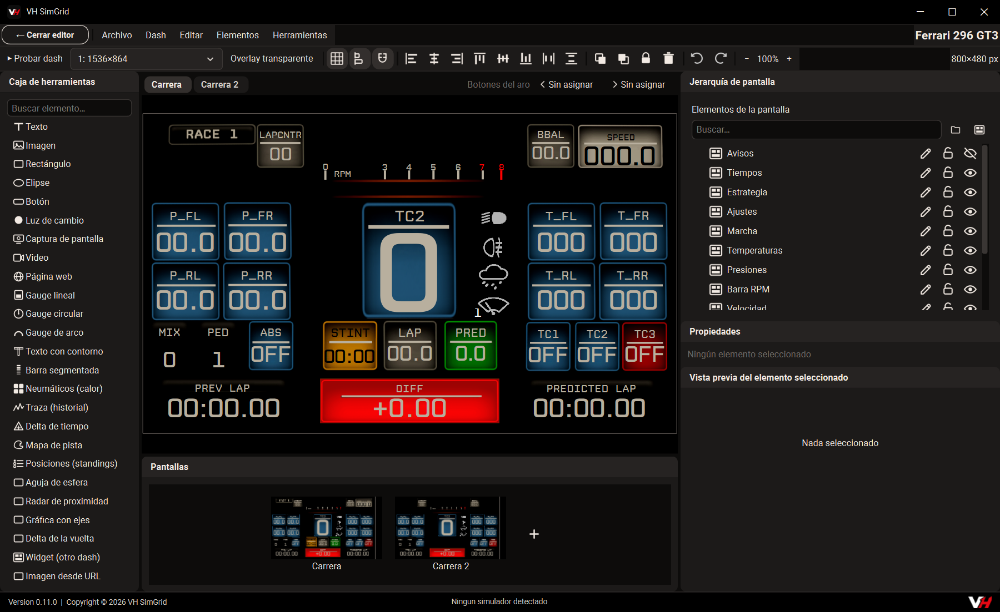

- **Menú del dash**: un dash especial que se abre con una combinación de
  botones del aro para cambiar ajustes sin soltar el volante. Puede lanzar
  macros: varias pulsaciones seguidas (por ejemplo, mapa de motor y modo de
  despliegue a la vez), comprobando por telemetría que han entrado

### Ingeniero de pista

Un ingeniero que **te habla por radio mientras conduces**. Se le pregunta por
voz con un botón del aro. Todo, la voz y el reconocimiento de lo que dices,
funciona en tu equipo.

- **Voz**: micrófono y altavoces, el botón para hablarle, la voz que usa
  (español o inglés) y el efecto de radio
- **Avisos**: qué te dice, por familias: spotter, combustible, ritmo, gomas,
  presiones, daños, rivales, tiempo, estrategia, boxes, el entrenador de
  conducción y el resultado al cruzar la meta. Cada familia se puede callar o
  hacer más habladora por separado, y la **personalidad** marca el tono
  general. Elige cuándo hablar para no hacerlo en plena frenada

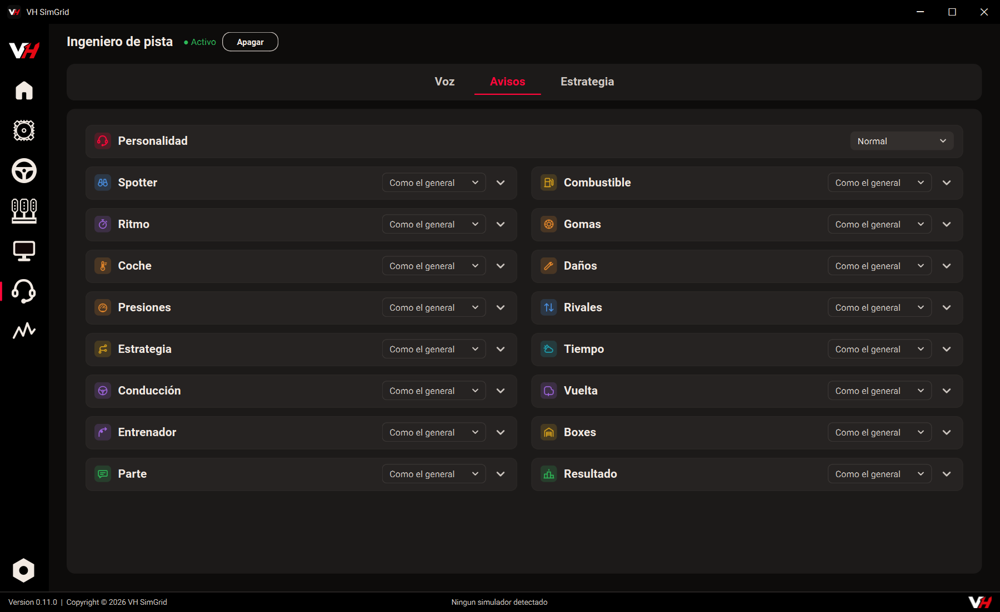

- **Estrategia**: una calculadora de estrategia con tus estrategias guardadas
  por coche y circuito. Compara opciones de paradas según el reglamento de la
  carrera (paradas obligatorias con ventana, juegos de gomas, repostaje,
  varios pilotos), deja mover las paradas a mano y muestra la gasolina y el
  ritmo vuelta a vuelta. Dentro tiene sus propias pestañas: *Carrera* (los
  datos: duración, ritmo, consumo, depósito, boxes, gomas), *Reglamento*,
  *Tandas* (qué se hace en cada parada) y *Clasificación* (cuánta gasolina
  echar). La estrategia que eliges es la que el ingeniero sigue en carrera,
  llamándote a boxes en la vuelta que toca. Con *Medir en pista*, en unos
  libres, el ingeniero te pide por radio lo que hay que rodar y la rellena con
  tus números

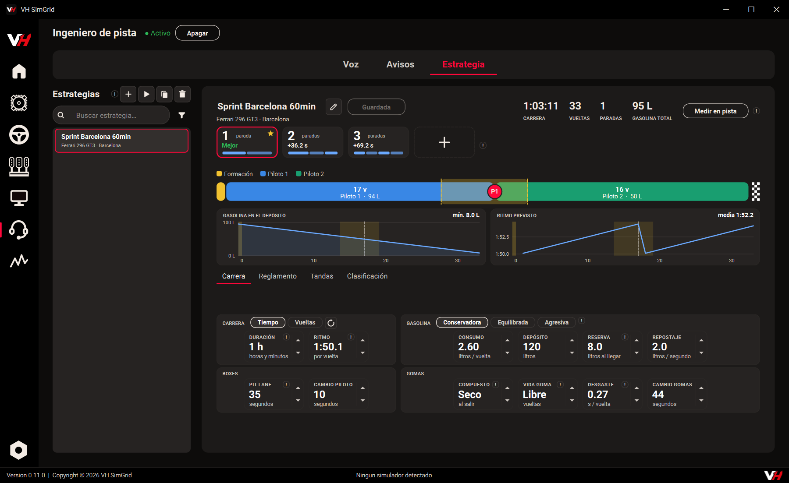

### Análisis

Cada sesión que corres se graba sola. Aquí se abren, al estilo de **MoTeC
i2**.

- **Sesiones**: la lista de grabaciones con buscador y filtros por juego,
  coche y circuito. Al lado, el trazado, los tiempos y las condiciones de la
  sesión elegida
- Al abrir una, cuatro pestañas de hojas: **Base** (comparar vueltas, delta,
  piloto, velocidad de ruedas, subviraje y sobreviraje, fuerzas,
  histogramas), **Vehículo** (neumáticos, ABS, frenos, suspensión, tracción,
  mapa motor y el estado del coche), **Suspensión** (cada esquina, alturas y
  barras estabilizadoras) y **Circuito** (el trazado pintado con la marcha,
  la velocidad o la frenada)
- Arriba, la vuelta, los sectores y las curvas para saltar a cada tramo; se
  compara contra una vuelta de referencia y el zoom es común a todas las
  gráficas

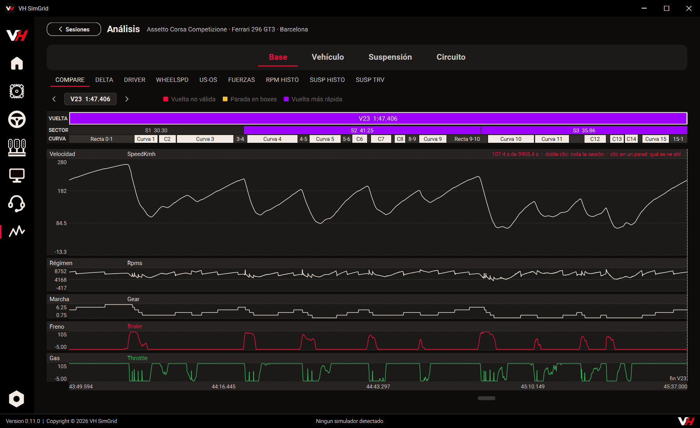

### Ajustes

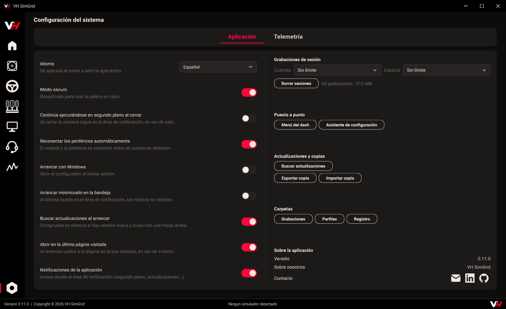

- **Aplicación**: idioma (español o inglés), modo oscuro o claro, arrancar
  con Windows o minimizado, seguir en segundo plano al cerrar, reconexión
  automática de los periféricos y aviso de actualizaciones. También el
  límite de grabaciones guardadas, el asistente de configuración, el menú del
  dash y la **copia de seguridad** de todos los ajustes y perfiles en un solo
  fichero
- **Telemetría**: los datos que está mandando el juego ahora mismo, variable
  a variable, para comprobar que llegan

### Juegos compatibles

**Telemetría de 18 juegos**: Assetto Corsa, ACC, AC EVO, AC Rally, Le Mans
Ultimate, iRacing, RaceRoom, Automobilista 1 y 2, rFactor 2, F1 (2023 a 2025),
DiRT Rally 2.0, EA WRC, BeamNG y los simuladores de camiones.

## Hardware

| Pieza | Base |
|---|---|
| Volante | MKS ODrive Mini (STM32F405) + motor de hoverboard |
| Pedalera | Arduino Micro + sensores Hall + célula de carga con INA333 |
| Aro | ATmega32U4 + LEDs WS2812 + matriz de botones + encoders (MCP23017) |

## Privacidad

Nada sale de tu equipo: la voz del ingeniero y el reconocimiento de lo que
dices funcionan en local, y tus grabaciones de telemetría se quedan en tu disco.

## Soporte

Si algo no funciona, abre una [incidencia](../../issues) indicando la versión
instalada y qué periférico falla. Desde la app, **Guardar diagnóstico** genera
un fichero con lo necesario para adjuntarlo.

## Licencia

Los binarios son **gratuitos para uso personal y no comercial**. No está
permitido lucrarse con ellos (venderlos, cobrar por instalarlos, usarlos en
equipos de alquiler o centros de simracing...) ni republicarlos fuera de este
repositorio (ver [LICENSE](LICENSE)). Compartir el enlace a este repositorio es
libre; para usos comerciales, contacta con el autor.

Incorporan componentes MIT de terceros (ODrive, TinyUSB) cuyos avisos de
copyright se conservan en el fichero de licencia. La voz y el reconocimiento
usan [Piper](https://github.com/rhasspy/piper) (MIT) y
[Vosk](https://alphacephei.com/vosk/) (Apache 2.0).

### Créditos de las voces

Cada voz del ingeniero viene de un dataset con su propia licencia:

| Voz | Origen | Licencia |
|---|---|---|
| *Lucía* (es_ES-sharvard) | [Sharvard Corpus](https://datashare.ed.ac.uk/handle/10283/574), V. Aubanel, M. L. García Lecumberri y M. Cooke, The University of Edinburgh | [CC BY 3.0](https://creativecommons.org/licenses/by/3.0/) |
| *Emily* (en_US-libritts_r) | [LibriTTS-R](https://www.openslr.org/141/) | [CC BY 4.0](https://creativecommons.org/licenses/by/4.0/) |
| *Harry* (en_GB-northern_english_male) | [openslr.org/83](https://www.openslr.org/83/) | [CC BY-SA 4.0](https://creativecommons.org/licenses/by-sa/4.0/) |
| *Sergio* (es_ES-davefx) | — | CC0 (dominio público) |

Las voces se distribuyen sin modificar, cada una con su ficha (`MODEL_CARD`)
junto al modelo.

## Contacto

  
  
  

---

Copyright © 2026 VH SimGrid

